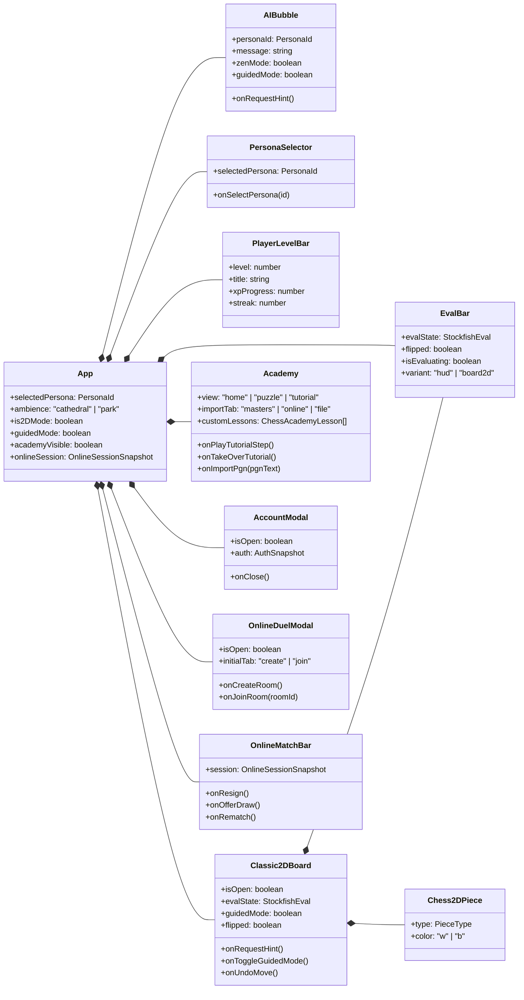
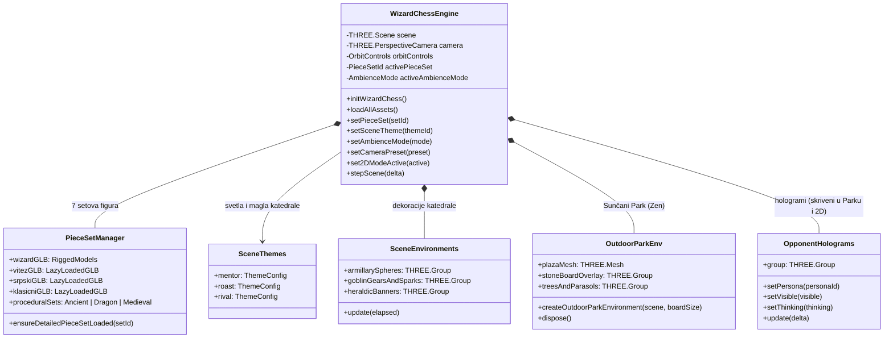
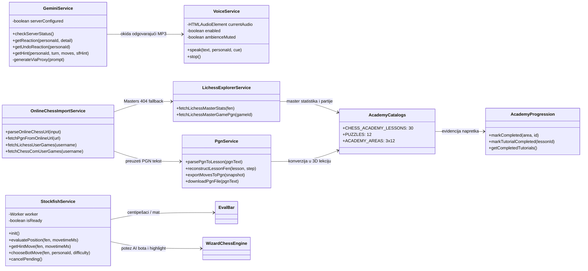
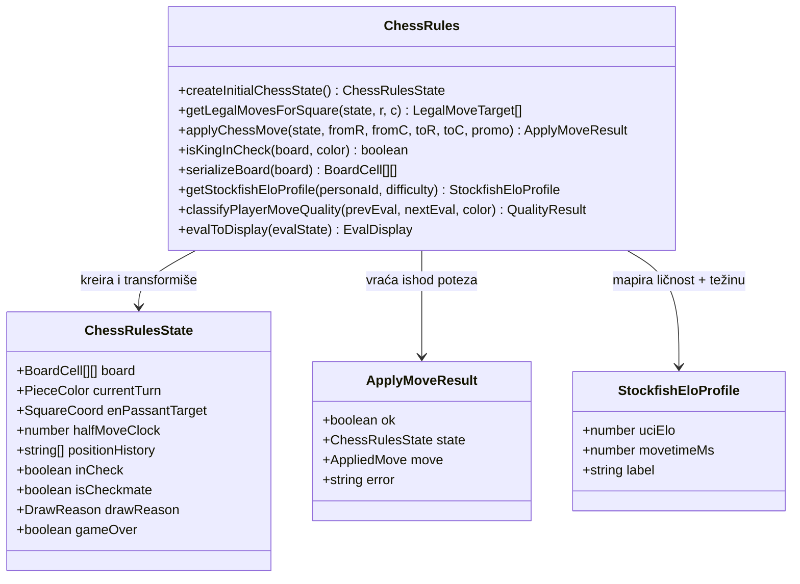
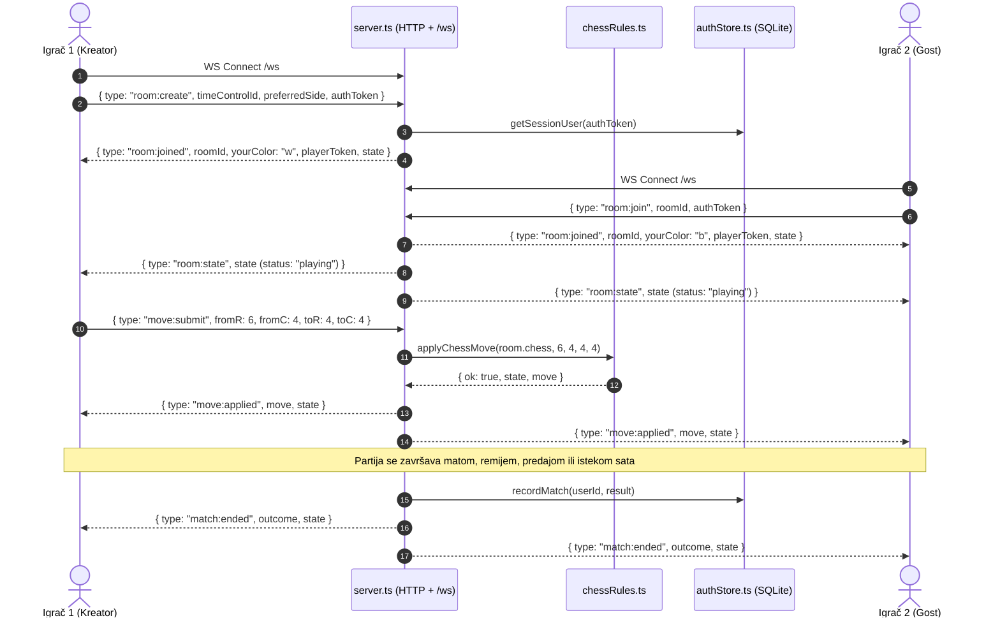

# Arhitektura projekta — Wizard Chess 3D

Ovaj dokument opisuje trenutnu full-stack arhitekturu projekta **Wizard Chess 3D**: organizaciju klijentskog React/Three.js sloja, integraciju **Stockfish 19 Lite WASM** endžina, **Vođeni režim**, PGN/Lichess/Chess.com servise, kao i Node/TypeScript backend server za korisničke naloge, Gemini posredovanje i onlajn 1-na-1 partije. Opis u potpunosti prati stvarno stanje u kodu.

---

## 1. Pregled sistema (Struktura direktorijuma)

Wizard Chess 3D se sastoji iz klijentske aplikacije (React 19 + TypeScript + Three.js) i jedinstvenog Node.js/Express servera (`server.ts`, port `3000`) koji opslužuje Vite dev middleware / produkcijski `dist/`, SQLite autentifikaciju, serverski Gemini proxy i WebSocket (`/ws`) za onlajn duele uz autoritativnu validaciju šahovskih pravila.

```text
index.html
  └── src/main.tsx
       ├── React StrictMode
       └── src/App.tsx
            ├── HUD (3 kapsule: Režimi, Partija, Podešavanja) i modali
            │    (AIBubble, Academy, AccountModal, OnlineDuelModal, OnlineMatchBar, EvalBar, Classic2DBoard)
            ├── stockfishService ── Web Worker (public/stockfish/stockfish-19-lite-single.*)
            ├── authService & multiplayerService ── REST API (/api/auth, /api/profile) & WebSocket (/ws)
            ├── pgnService, lichessExplorerService & onlineChessImportService
            ├── geminiService ── serverski proxy (/api/gemini/*) / lokalni fallback
            ├── progressionService & academyProgression ── localStorage + sinhronizacija sa nalogom
            ├── sceneThemes, sceneEnvironments, opponentHolograms & outdoorParkEnv ── Three.js ambijenti
            ├── voiceService & soundService ── lokalni MP3 glasovi i Web Audio SFX
            └── initWizardChess() ── src/wizardChessEngine.js (Three.js + lokalni engine + window.wizardChess API)

server.ts (Express 5 + WebSocket + Vite/dist)
  ├── src/server/authStore.ts ── SQLite (node:sqlite) korisnički nalozi, sesije, XP i istorija partija
  ├── /api/gemini/* ── @google/genai proxy (gemini-3.1-flash-lite, GEMINI_API_KEY na serveru)
  ├── src/shared/chessRules.ts ── deljena šahovska pravila za validaciju poteza i Stockfish ELO profile
  └── WebSocket menadžer soba (/ws) ── kreiranje soba, autoritativni satovi i prenos poteza uživo

public/assets/
  ├── glb/                 kompresovani 3D modeli (.glb.gz.b64) — katedrala i 4 GLB seta figura
  ├── audio/voices/        unapred generisani MP3 glasovni komentari (mentor, roast, rival)
  └── stockfish/           Stockfish 19 Lite WASM binarni i single-threaded JS worker fajlovi
```

---

## 2. Arhitekturni dijagrami (Mermaid)

### 2.1. Globalni koncept sistema (Visoki nivo)

Ovaj dijagram prikazuje komunikaciju između igrača, pregledača (React + Three.js + Stockfish Web Worker), Node.js backenda (`server.ts`) i eksternih servisa.

```mermaid
flowchart TB
    User(["Igrač (Pregledač / Mobilni)"])

    subgraph Browser["Klijentska aplikacija (React 19 + TypeScript)"]
        UI["React HUD, 2D Tabla i Akademija"]
        ThreeEngine["Three.js 3D Scena (wizardChessEngine.js)"]
        SharedClient["Deljena pravila & ELO profili (chessRules.ts)"]
        StockfishWorker["Stockfish 19 Lite WASM (Web Worker)"]
        AudioEngine["Glasovni MP3 i Web Audio SFX"]
    end

    subgraph Backend["Sopstveni Backend (server.ts)"]
        RestAuth["REST API (/api/auth/*, /api/profile/*)"]
        GeminiProxy["Gemini Proxy (/api/gemini/status, /generate)"]
        WSHub["WebSocket Menadžer Soba (/ws)"]
        AuthDB["AuthStore (node:sqlite + scrypt)"]
        SharedServer["Serverska validacija (chessRules.ts)"]
    end

    subgraph External["Spoljni servisi (Opcioni / Javni)"]
        LichessAPI["Lichess Masters & Lichess.org API"]
        ChessComAPI["Chess.com Public API"]
        GeminiAPI["Google Gemini API (@google/genai)"]
    end

    User <-->|Klik / Dodir / Kamera| UI
    User <-->|3D Interakcija| ThreeEngine
    UI <-->|CustomEvents & window.wizardChess| ThreeEngine
    UI <--> SharedClient
    UI <-->|Evaluacija, Savet, Vođeni režim| StockfishWorker
    ThreeEngine <-->|AI potez po ELO profilu| StockfishWorker
    UI --> AudioEngine

    UI <-->|HTTPS JSON + Bearer Token| RestAuth
    UI -.->|POST /api/gemini/generate| GeminiProxy
    UI <-->|WebSocket uživo (/ws)| WSHub
    RestAuth <--> AuthDB
    WSHub <--> SharedServer
    WSHub --> AuthDB

    UI -.->|FEN statistika, studije, partije| LichessAPI
    UI -.->|Mesečne arhive igrača| ChessComAPI
    GeminiProxy -.->|GEMINI_API_KEY na serveru| GeminiAPI
```

### 2.2. Opšti dijagram klasa i modula

Pregled ključnih modula na klijentu i serveru i njihovih stvarnih zavisnosti:

```mermaid
classDiagram
    direction TB

    class App {
        -PersonaId selectedPersona
        -AmbienceMode ambience
        -boolean is2DMode
        -boolean guidedMode
        -boolean academyVisible
        +handleSelectPersona(id)
        +handleMoveEvent(detail)
        +handleRequestHint()
        +handleToggleGuidedMode()
        +handleExportPgn()
    }

    class WizardChessEngine {
        -THREE.Scene scene
        -THREE.WebGLRenderer renderer
        -BoardState boardState
        -string currentTurn
        +initWizardChess()
        +executeChessMove(fromR, fromC, toR, toC, opts)
        +setSceneTheme(themeId)
        +setAmbienceMode(mode)
        +setPieceSet(setId)
        +undoPlayerMove()
        +showHintHighlight(fromR, fromC, toR, toC)
        +getHintHighlight()
        +getFallbackBestMove()
        +getGameContext()
    }

    class OutdoorParkEnv {
        +createOutdoorParkEnvironment(scene, boardSize)
        +dispose()
    }

    class OpponentHolograms {
        +setPersona(personaId)
        +setVisible(visible)
        +setThinking(thinking)
        +update(delta)
    }

    class StockfishService {
        -Worker worker
        +evaluatePosition(fen, movetimeMs)
        +getHintMove(fen, movetimeMs)
        +chooseBotMove(fen, personaId, difficulty)
        +cancelPending()
        +newGame()
    }

    class PgnService {
        +parsePgnToLesson(pgnText)
        +reconstructLessonFen(lesson, stepIndex)
        +exportMovesToPgn(snapshot)
        +downloadPgnFile(pgnText)
    }

    class LichessExplorerService {
        +fetchLichessMasterStats(fen)
        +getCachedLichessMasterStats(fen)
        +fetchLichessMasterGamePgn(gameId)
    }

    class OnlineChessImportService {
        +parseOnlineChessUrl(rawInput)
        +fetchPgnFromOnlineUrl(rawUrl)
        +fetchLichessUserGames(username)
        +fetchChessComUserGames(username)
    }

    class GeminiService {
        -boolean serverConfigured
        +checkServerStatus()
        +getReaction(personaId, detail)
        +getUndoReaction(personaId)
        +getHint(personaId, turn, moves, sfHint)
    }

    class VoiceService {
        +isEnabled()
        +toggleVoice()
        +setAmbienceMuted(muted)
        +speak(text, personaId, cue)
    }

    class SoundService {
        +playMove()
        +playCapture()
        +playCheck()
        +playCheckmate()
        +playUndo()
        +playBlunder()
    }

    class ProgressionService {
        +awardMove(capture, check, mate, draw)
        +awardHint()
        +recordOpponentMove(capture, mate)
        +replaceFromCloud(stats)
    }

    class AuthService {
        -string token
        +login(username, password)
        +register(username, password, displayName)
        +syncProgress(stats, academy)
        +recordSinglePlayerMatch(match)
    }

    class MultiplayerService {
        -WebSocket ws
        +createRoom(timeControl, side, avatar)
        +joinRoom(roomId, avatar)
        +submitMove(fromR, fromC, toR, toC, promo)
        +resign()
        +offerDraw()
        +requestRematch()
    }

    class ServerTS {
        -Map~string, RoomRecord~ rooms
        +handleAuthRoutes()
        +handleProfileRoutes()
        +handleGeminiProxyRoutes()
        +handleWebSocketUpgrade()
    }

    class RoomRecord {
        +string roomId
        +RoomStatus status
        +ChessRulesState chess
        +ClockState clock
        +PlayerSlot w
        +PlayerSlot b
    }

    class AuthStore {
        +registerUser(input)
        +loginUser(input)
        +getSessionUser(token)
        +syncProgress(userId, stats, academy)
        +recordMatch(userId, match)
    }

    class ChessRules {
        +createInitialChessState()
        +applyChessMove(state, fromR, fromC, toR, toC, promo)
        +getLegalMovesForSquare(state, r, c)
        +getStockfishEloProfile(personaId, difficulty)
        +classifyPlayerMoveQuality(prev, next, color)
        +evalToDisplay(evalState)
    }

    App --> WizardChessEngine : upravlja preko window.wizardChess
    App --> StockfishService : eval, savet i Vođeni režim
    App --> AuthService : prijava, profil i istorija
    App --> MultiplayerService : 1-na-1 duel uživo
    App --> PgnService : uvoz/izvoz partija
    App --> GeminiService : komentari i objašnjenja
    App --> VoiceService : MP3 glasovi
    App --> SoundService : Web Audio SFX
    App --> ProgressionService : XP i titule

    WizardChessEngine *-- OutdoorParkEnv : parkovski Zen ambijent
    WizardChessEngine *-- OpponentHolograms : 3D hologramski rivali
    WizardChessEngine --> StockfishService : chooseBotMove() za AI poteze
    OnlineChessImportService --> LichessExplorerService : fallback 404 na Masters PGN

    AuthService ..> ServerTS : REST API (/api/auth, /api/profile)
    GeminiService ..> ServerTS : REST API (/api/gemini/*)
    MultiplayerService ..> ServerTS : WebSocket (/ws)

    ServerTS *-- RoomRecord : upravlja sobama i satovima
    ServerTS --> AuthStore : SQLite nalozi i partije
    ServerTS --> ChessRules : serverska validacija poteza
    App ..> ChessRules : ocena poteza i eval prikaz
    StockfishService ..> ChessRules : ELO profili i UCI parsiranje
```



### 2.3. Modul: Frontend UI i HUD komponente

Prikazuje hijerarhiju React komponenti u `src/App.tsx`, raspored donjih kontrola u 3 kapsule (`Režimi`, `Partija`, `Podešavanja`) i sinhronizaciju 2D/3D table.



### 2.4. Modul: 3D Engine, Ambijenti i Vizuelni resursi

Unutrašnja organizacija Three.js scene, upravljanje sa 7 setova figura (GLB sa lazy-load mehanizmom i proceduralnim setovima), kamerama i prebacivanjem između Katedrale i Parka.



### 2.5. Modul: AI Engine, Analiza, PGN, Lichess/Chess.com i Akademija

Povezuje Stockfish 19 WASM analizu, Vođeni režim, Gemini posredovanje, PGN uvoz/izvoz, Lichess Masters / Lichess.org / Chess.com servise i kataloge Akademije.



### 2.6. Modul: Deljena šahovska logika (`src/shared/chessRules.ts`)

Čist TypeScript modul bez spoljnih zavisnosti koji obezbeđuje deterministička pravila za online server, kao i Stockfish ELO profile i ocenu kvaliteta poteza.



### 2.7. Modul: Backend Server i Multiplayer tok (`server.ts`)

Prikazuje stvarnu razmenu WebSocket poruka na `/ws` za kreiranje sobe, priključenje, autoritativne satove, validaciju poteza i evidenciju ishoda u SQLite bazi.



---

## 3. Ulazna tačka i životni ciklus

1. [server.ts](./server.ts) pokreće Express aplikaciju (sa Vite dev middleware-om u razvoju ili `dist/` fajlovima u produkciji), inicijalizuje SQLite `authStore` i vezuje WebSocket server na `/ws`.
2. [index.html](./index.html) učitava [src/main.tsx](./src/main.tsx), koji montira `<App />` unutar `React.StrictMode` i uvozi stilove iz [src/styles.css](./src/styles.css).
3. [src/App.tsx](./src/App.tsx) renderuje HUD (3 kapsule: `Režimi`, `Partija`, `Podešavanja`), AI oblačić, `EvalBar`, modale i jednom poziva `initWizardChess()`, primenjujući sačuvana podešavanja (`wizard_chess_piece_set`, `wizard_chess_ai_difficulty`, `wizard_chess_ambience`, `wizard_chess_guided_mode`).
4. [src/wizardChessEngine.js](./src/wizardChessEngine.js) pravi WebGL renderer u `#canvas-container`, učitava katedralu, osnovni `wizard` fallback i podrazumevani `klasicni` set (ili drugi sačuvani GLB set iz `localStorage`), postavlja izabrani 3D ambijent i izlaže `window.wizardChess` API.

---

## 4. Mapa fajlova i modula

### Backend i deljena logika

| Fajl | Odgovornost |
| --- | --- |
| [server.ts](./server.ts) | Express HTTP server, Vite middleware / statički `dist/`, `/api/auth/*` i `/api/profile/*` rute, `/api/gemini/*` proxy (`gemini-3.1-flash-lite`) i WebSocket (`/ws`) server za online duele sa autoritativnim satovima. |
| [src/server/authStore.ts](./src/server/authStore.ts) | Perzistencija korisnika, sesija, spoja gostujućeg napretka i istorije partija u SQLite bazi (`node:sqlite`, `scrypt` heširanje lozinki). |
| [src/shared/chessRules.ts](./src/shared/chessRules.ts) | Autoritativna deljena šahovska pravila za server i klijent, Stockfish ELO profili (`getStockfishEloProfile`), normalizacija evaluacije (`evalToDisplay`), klasifikacija kvaliteta poteza (`classifyPlayerMoveQuality`) i orijentacija 2D table. |
| [src/shared/multiplayerTypes.ts](./src/shared/multiplayerTypes.ts) | Tipovi WebSocket poruka (`ClientWsMessage`, `ServerWsMessage`), stanje sobe i vremenske kontrole (`3+2`, `5+0`, `10+0`, `15+10`). |
| [src/shared/authTypes.ts](./src/shared/authTypes.ts) | Tipovi za korisničke profile, oblak/lokalni napredak i evidenciju završenih partija. |

### Frontend komponente

| Fajl | Odgovornost |
| --- | --- |
| [src/App.tsx](./src/App.tsx) | Glavni orkestrator: HUD sa 3 kapsule (`Režimi`, `Partija`, `Podešavanja`), Stockfish evaluacija i detekcija blundera, ručni `💡 Savet` i automatski **Vođeni režim (`🧭 Vođeni`)**, PGN izvoz, Akademija i online sesija. |
| [src/components/AIBubble.tsx](./src/components/AIBubble.tsx) | AI oblačić sa tekstualnim komentarima, kontrolom glasa (`🌿 Zen` u Park režimu) i dugmetom `💡 Savet` (prikazuje status Vođenog režima kada je uključen iz donjeg menija). |
| [src/components/EvalBar.tsx](./src/components/EvalBar.tsx) | Vertikalna Stockfish traka prednosti za 3D HUD (`hud`) i 2D tablu (`board2d`), sa prikazom centipešaka/mata. |
| [src/components/Classic2DBoard.tsx](./src/components/Classic2DBoard.tsx) | Klasični 2D Staunton modal sinhronizovan sa engine-om, sa `EvalBar` trakom, okretanjem table, `💡 Savet` i `🧭 Vođeni` dugmićima i trenutnim potezima. |
| [src/components/Chess2DPiece.tsx](./src/components/Chess2DPiece.tsx) | Vektorski (SVG) prikaz šest šahovskih figura za 2D tablu i modal promocije pešaka. |
| [src/components/Academy.tsx](./src/components/Academy.tsx) | Šahovska akademija: zagonetke, kviz lekcije, **3D Tutorijal** (30 kuriranih + uvezene PGN partije), Lichess Masters statistika i 3-tab uvoznik (Lichess Masters, Lichess/Chess.com, Fajl/Tekst). |
| [src/components/OnlineDuelModal.tsx](./src/components/OnlineDuelModal.tsx) | Kreiranje i pridruživanje online duel sobi putem 6-karakternog koda ili pozivnog linka. |
| [src/components/OnlineMatchBar.tsx](./src/components/OnlineMatchBar.tsx) | Prikaz satova, protivnika, ponude remija, predaje i zahteva za revanš tokom online partije. |
| [src/components/AccountModal.tsx](./src/components/AccountModal.tsx) | Prijava, registracija, promena imena, pregled statistike i istorije partija. |
| [src/components/PersonaSelector.tsx](./src/components/PersonaSelector.tsx) | Izbor AI ličnosti (`mentor`, `roast`, `rival`) za desktop i mobilni meni. |
| [src/components/PlayerLevelBar.tsx](./src/components/PlayerLevelBar.tsx) | Prikaz RPG nivoa, titule, XP napretka i niza uzimanja. |

### Engine, 3D okruženja i servisi

| Fajl | Odgovornost |
| --- | --- |
| [src/wizardChessEngine.js](./src/wizardChessEngine.js) | Centralni Three.js i šahovski engine: GLB/proceduralni setovi figura, katedrala i Park (Zen) scena, pravila, animacije, lokalni AI fallback, `showHintHighlight` / `getHintHighlight` / `getFallbackBestMove`, Akademija / 3D Tutorijal i `window.wizardChess` API. |
| [src/three/environments/outdoorParkEnv.ts](./src/three/environments/outdoorParkEnv.ts) | Proceduralno dnevno okruženje **Sunčani Park (Zen režim)**: popločani trg, ugrađena kamena tabla visokog kontrasta, drveće sa senkama i suncobrani. |
| [src/services/sceneThemes.ts](./src/services/sceneThemes.ts) | Palete svetla, magle i kamenih materijala za `mentor`, `roast` i `rival` teme u katedrali. |
| [src/services/sceneEnvironments.ts](./src/services/sceneEnvironments.ts) | Proceduralni 3D dekorativni elementi za tri teme katedrale. |
| [src/services/opponentHolograms.ts](./src/services/opponentHolograms.ts) | 3D hologramski avatari protivnika u katedrali (automatski skriveni u Park/Zen režimu i 2D prikazu). |
| [src/services/stockfishService.ts](./src/services/stockfishService.ts) | Web Worker red za `/stockfish/stockfish-19-lite-single.js` (`evaluatePosition`, `getHintMove`, `chooseBotMove`), sa `MultiPV` kalibracijom za nivoe ispod 1320 Elo (`Početnik`, `Rekreativac`) i `UCI_LimitStrength` za `Srednji` / `Napredni` / `Majstor`, otporan na `StrictMode` remount. |
| [src/services/geminiService.ts](./src/services/geminiService.ts) | Pozivi ka `/api/gemini/*` za karakterne reakcije, undo komentare i objašnjenja saveta uz bogate lokalne fallback odgovore. |
| [src/services/pgnService.ts](./src/services/pgnService.ts) | Parsiranje PGN zapisa (`chess.js`) u 3D Tutorijal lekcije, uklanjanje `[%clk]`/`[%eval]` tagova, rekonstrukcija FEN-a po koracima, lokalno čuvanje i izvoz partija u PGN. |
| [src/services/lichessExplorerService.ts](./src/services/lichessExplorerService.ts) | Upiti ka `explorer.lichess.ovh/masters` sa keširanjem, računanjem W/D/L procenata, listom `topGames`, preuzimanjem master PGN partija i 60s zaštitom na HTTP `429`. |
| [src/services/onlineChessImportService.ts](./src/services/onlineChessImportService.ts) | Parsiranje Lichess URL-ova (partije, studije, poglavlja uz fallback na Masters PGN), preuzimanje Lichess NDJSON partija igrača i Chess.com mesečnih arhiva. |
| [src/data/chessAcademyLessons.ts](./src/data/chessAcademyLessons.ts) | 30 kuriranih lekcija za 3D Tutorijal (*Otvaranja*, *Odbrana*, *Poznate partije*). |
| [src/services/academyCatalog.ts](./src/services/academyCatalog.ts) | Po 12 kviz-lekcija u oblastima *Poznate partije*, *Otvaranja* i *Strategija*. |
| [src/services/puzzleCatalog.ts](./src/services/puzzleCatalog.ts) | 12 proverenih mat-u-jednom zagonetki sa pozicijama i po 3 nagoveštaja. |
| [src/services/academyProgression.ts](./src/services/academyProgression.ts) | Čuvanje završenih zagonetki, kvizova i 3D tutorijala u `localStorage` i sinhronizacija sa nalogom. |
| [src/services/progressionService.ts](./src/services/progressionService.ts) | RPG XP, nivoi, titule i statistika igrača (`localStorage` + sinhronizacija sa serverom). |
| [src/services/authService.ts](./src/services/authService.ts) | Klijentski auth servis sa Bearer sesijama, automatskom sinhronizacijom napretka i evidencijom partija. |
| [src/services/multiplayerService.ts](./src/services/multiplayerService.ts) | WebSocket klijent za online sobe, rekonekciju, poteze i satove. |
| [src/services/voiceService.ts](./src/services/voiceService.ts) | Reprodukcija MP3 komentara iz `public/assets/audio/voices/`, utišavanje u Park/Zen režimu. |
| [src/services/soundService.ts](./src/services/soundService.ts) | Web Audio API zvučni efekti (potez, uzimanje figure, šah, mat, undo, blunder upozorenje). |

---

## 5. Tokovi podataka i režimi rada

### Single-player, Stockfish analiza i Vođeni režim

1. **Inicijalizacija i red čekanja:** `stockfishService.init()` pokreće `/stockfish/stockfish-19-lite-single.js` u Web Worker-u kroz sekvencijalni FIFO red sa epohom za bezbedno otkazivanje (`cancelPending`).
2. **Evaluacija i detekcija blundera:** Na svaki `wizardchess:move` u single-player režimu (van Akademije), `App.tsx` evaluira novu FEN poziciju, osvežava `EvalBar` i poredi evaluaciju pre/posle poteza igrača putem `classifyPlayerMoveQuality(...)`. Veliki pad prednosti označava potez kao `blunder` i aktivira reakciju i zvučni signal.
3. **Ručni savet (`💡 Savet`) i Vođeni režim (`🧭 Vođeni`):**
   - Zajednička rutina `runMoveHint` koristi `stockfishService.getHintMove(...)` (ili `window.wizardChess.getFallbackBestMove()` kada WASM nije dostupan) da pronađe najbolji potez, odmah ga označava na tabli preko `showHintHighlight(fromR, fromC, toR, toC)` (što ažurira 3D prstenove i `wizardchess:hint` događaj za `Classic2DBoard`) i traži kratko objašnjenje preko `geminiService.getHint(...)`.
   - **Vođeni režim (`guidedMode`)** uključuje se u donjoj kapsuli *Režimi* (`#btn-guided-mode`) pored dugmeta za Katedralu/Park, kao i u 2D tabli (`#btn-2d-guided`), a izbor se pamti u `localStorage` (`wizard_chess_guided_mode`).
   - Kada je Vođeni režim uključen, preporuka se automatski prikazuje čim je igrač na potezu (odmah po uključivanju, po završetku AI poteza, na startu nove partije kao beli, nakon `⏳ Vrati`, po izlasku iz Akademije i posle *Igraj odavde*). Automatske preporuke ne dodeljuju XP za savet, a isključivanjem režima se postojeće oznake odmah uklanjaju (`clearHintHighlight()`).

### 3D scena, ambijenti i Akademija

- **Ambijenti (`setAmbienceMode('cathedral' | 'park')`):** U `park` režimu učitava se proceduralni trg iz `outdoorParkEnv.ts` sa kamenom tablom u ravni pločnika, dok su 3D hologram protivnika i glasovni komentari skriveni/utišani (`voiceService.setAmbienceMuted(true)`). Promena ambijenta i seta figura ne resetuje partiju.
- **Setovi figura (`setPieceSet(...)`):** Podržani su `klasicni` (podrazumevani set za nove korisnike), `wizard`, `ancient`, `dragon`, `medieval`, `vitez` i `srpski`. Dodatni GLB setovi (`vitez`, `srpski`, odnosno `klasicni` ako korisnik ima sačuvan drugi set) dekompresuju se iz `public/assets/glb/` tek kada su potrebni.
- **Akademija i 3D Tutorijal:** Ulazak u zagonetku ili 3D tutorijal snima stanje tekuće single-player partije. Korisnik može da uvozi partije iz Lichess Masters baze, Lichess/Chess.com linkova i profila ili lokalnih `.pgn` fajlova i da nastavi bilo koju poziciju protiv AI-ja pomoću `takeOverAcademyGame(...)`.

### Onlajn 1-na-1 dueli i korisnički nalozi

- Tokom online sobe (`gameMode === 'online'`), svaka provera legalnosti poteza, vremenske kontrole (`3+2`, `5+0`, `10+0`, `15+10`), ponude remija, predaje i revanša sa zamenom boja izvršava se na serveru u `server.ts` pomoću `src/shared/chessRules.ts`. Klijentski Stockfish worker, `EvalBar`, AI saveti, Vođeni režim i Undo automatski se isključuju radi fer-pleja.
- `src/server/authStore.ts` čuva naloge, sesije i istoriju single-player i online partija u SQLite bazi (`node:sqlite`).

---

## 6. Granica između React-a i engine-a

1. **DOM selektori** za dugmad kontrole partije (`btn-reset`, `btn-ai-move`, `btn-side-toggle`, `btn-hide-ui`).
2. **`CustomEvent` događaji** (`wizardchess:move`, `wizardchess:reset`, `wizardchess:undo`, `wizardchess:hint`, `wizardchess:academy-move`, `wizardchess:online-move-submit`, `wizardchess:cameraview`, `wizardchess:pieceset-loading`, `wizardchess:promotion-request`).
3. **`window.wizardChess` API** (`executeChessMove`, `undoPlayerMove`, `showHintHighlight`, `clearHintHighlight`, `getHintHighlight`, `getFallbackBestMove`, `setPieceSet`, `setAIDifficulty`, `setAmbienceMode`, `set2DModeActive`, `enterAcademyTutorial`, `takeOverAcademyGame`, `getMoveHistory`, `getGameContext` i online sinhronizaciju).

---

## 7. Konfiguracija, pokretanje i testovi

| Komanda | Svrha |
| --- | --- |
| `npm run dev` | Full-stack razvojni server (`tsx server.ts`), port 3000. |
| `npm run build` | Vite produkcijski build u `dist/`. |
| `npm start` | Produkcijski server (`node server.ts`). |
| `npm run lint` | `tsc --noEmit` provera TypeScript tipova. |
| `npm test` | Izvršava sve testove u `test/applet.test.mjs`. |
